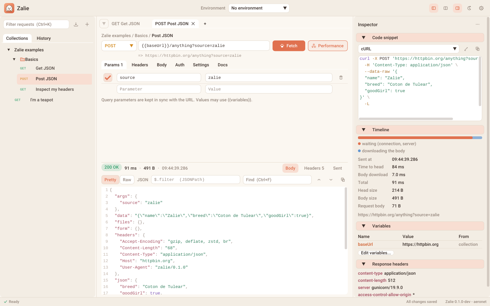

<p align="center">
  
</p>

<h1 align="center">Zalie</h1>

<p align="center">
  A light, fast and friendly HTTP client, written in C++23.<br>
  <a href="https://sjanel.github.io/zalie/">Documentation</a> ·
  <a href="https://sjanel.github.io/zalie/getting-started/install/">Install</a> ·
  <a href="docs/CHANGELOG.md">Changelog</a>
</p>

<p align="center">
  <a href="https://github.com/sjanel/zalie/actions/workflows/linux.yml"></a>
  <a href="https://github.com/sjanel/zalie/actions/workflows/macos.yml"></a>
  <a href="https://github.com/sjanel/zalie/actions/workflows/windows.yml"></a>
  <a href="https://github.com/sjanel/zalie/actions/workflows/package.yml"></a>
  <a href="https://github.com/sjanel/zalie/actions/workflows/clang-format.yml"></a>
  <a href="https://github.com/sjanel/zalie/actions/workflows/docs.yml"></a>
  <a href="https://codecov.io/gh/sjanel/zalie"></a>
</p>



Zalie keeps the good ideas of Bruno and Postman (collections, environments, code snippets) in a native application of
a few megabytes, built on the [aeronet](https://github.com/sjanel/aeronet) HTTP client. It is named after a fluffy
Coton de Tulear, who runs across the screen while your requests are in flight.

## Features

- **Collections** of folders and requests in the left panel, the **request editor** and the **response** in the
  center, a configurable **inspector** on the right (code snippets, timeline, variables, headers).
- HTTP/1.1 and HTTP/2, https, gzip / deflate / zstd / brotli, redirects, timeouts, cancellation.
- Variables, environments and dynamic variables (`{{$timestamp}}`, `{{$randomUUID}}`, `{{process.env.TOKEN}}`).
- Snippets in curl, HTTPie, Wget, PowerShell, Python, JavaScript, Go, C++ (aeronet) and raw HTTP.
- Import Bruno collections, Postman exports and curl commands (paste one in the URL bar).
- One pretty-printed JSON file per collection: git friendly, autosaved.
- Smooth with any response size: bodies are formatted off the UI thread, only visible lines are drawn.
- JSONPath filter of JSON responses (`$.results[*].id`, `$..price`), the response below or beside the request.
- Idle means idle: no frame is drawn while nothing changes.
- Two themes, Coton (light) and Nuit (dark). Linux, macOS, Windows. Local only: no account, no cloud.

## Download

Packages for Debian / Ubuntu (`.deb`), Windows (zip) and macOS (disk image, Apple Silicon) are attached to each
[release](https://github.com/sjanel/zalie/releases): see the
[installation guide](https://sjanel.github.io/zalie/getting-started/install/#download).

## Build

Requirements: CMake 3.28+, a C++23 compiler (GCC 13+, Clang 22+, MSVC 2022), OpenSSL, and on Linux the X11
headers. All other dependencies are fetched and pinned by CMake.

```bash
# Debian / Ubuntu
sudo apt install build-essential cmake ninja-build libssl-dev \
  libx11-dev libxrandr-dev libxinerama-dev libxcursor-dev libxi-dev libxext-dev

cmake --preset release
cmake --build --preset release
./build/release/bin/zalie
```

Tests (unit, integration against a local aeronet server, and the UI driven headless):

```bash
cmake --preset debug && cmake --build --preset debug && ctest --preset debug
```

See the [installation guide](https://sjanel.github.io/zalie/getting-started/install/) for macOS, Windows and the
build options.

## Documentation

The documentation is written with [MkDocs Material](https://squidfunk.github.io/mkdocs-material/) in `docs/`:

```bash
pip install -r requirements-docs.txt
mkdocs serve
```

## License

[MIT](LICENSE). Zalie embeds [Dear ImGui](https://github.com/ocornut/imgui) (MIT), [GLFW](https://www.glfw.org)
(zlib), [glaze](https://github.com/stephenberry/glaze) (MIT), [stb](https://github.com/nothings/stb) (public domain),
and the Roboto and Cousine fonts (Apache 2.0).
