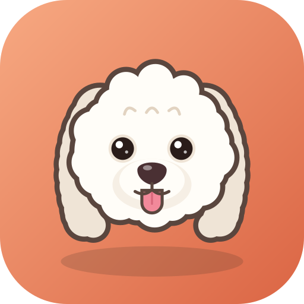
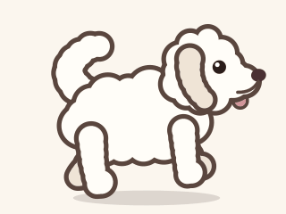
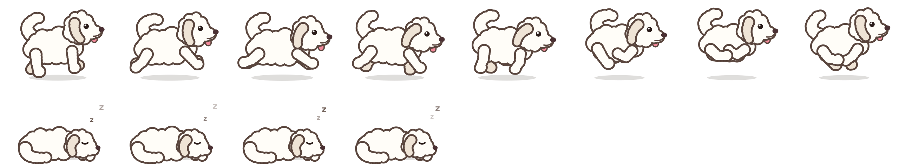

# Artwork

<div class="zalie-hero" markdown>

{ .zalie-logo }

</div>

The logo, the running dog and the themes are drawn after Zalie herself: a white, fluffy Coton de Tulear with long
floppy ears, dark round eyes, a brown-pink nose, a pink tongue and a plumed tail curled over her back.

Everything is **procedural**: `tools/generate-assets.py` describes the drawings in SVG from a few shapes and
constants, Inkscape rasterizes them and Pillow assembles the sprite sheet. No hand-made bitmap to keep in sync: change
a color or a proportion, run the script, done.

```bash
pip install pillow          # and Inkscape 1.x in the PATH
tools/generate-assets.py    # writes assets/logo and assets/sprites
tools/take-screenshots.sh   # then refresh the images of the documentation
```

The generated files are committed: building Zalie needs neither Python nor Inkscape.

## The fur trick

A fluffy shape (`Blob`) is a union of circles: scalloped circles along an ellipse, plus a few large ones filling it.
It is drawn twice: first every circle enlarged by the outline width, in the outline color, then every circle in the
fur color. The outline thus only remains on the outer contour of the union, which makes the silhouette look like a
cloud of fur, at any size.

## Palette

| Role | Color | |
| ---- | ----- | - |
| Fur | `#FFFDF8` | <span class="zalie-swatch" style="background:#FFFDF8"></span> |
| Fur shade | `#EFE4D6` | <span class="zalie-swatch" style="background:#EFE4D6"></span> |
| Outline | `#5A463E` | <span class="zalie-swatch" style="background:#5A463E"></span> |
| Eyes | `#2A1C19` | <span class="zalie-swatch" style="background:#2A1C19"></span> |
| Nose | `#4A3033` | <span class="zalie-swatch" style="background:#4A3033"></span> |
| Tongue | `#F2899A` | <span class="zalie-swatch" style="background:#F2899A"></span> |
| Badge (gradient) | `#F7A982` to `#DB6544` | <span class="zalie-swatch" style="background:linear-gradient(#F7A982,#DB6544)"></span> |

The interface themes (`src/ui/src/theme.cpp`) reuse it:

| | Coton (light) | Nuit (dark) |
| - | ------------- | ----------- |
| Background | `#FBF7F1` <span class="zalie-swatch" style="background:#FBF7F1"></span> | `#1C1917` <span class="zalie-swatch" style="background:#1C1917"></span> |
| Panels | `#F3EDE4` <span class="zalie-swatch" style="background:#F3EDE4"></span> | `#23201D` <span class="zalie-swatch" style="background:#23201D"></span> |
| Text | `#3B302B` <span class="zalie-swatch" style="background:#3B302B"></span> | `#EDE6DF` <span class="zalie-swatch" style="background:#EDE6DF"></span> |
| Accent (terracotta) | `#E0714F` <span class="zalie-swatch" style="background:#E0714F"></span> | `#EC7F5C` <span class="zalie-swatch" style="background:#EC7F5C"></span> |

## Files

| File | Use |
| ---- | --- |
| `assets/logo/zalie-logo.svg` | logo with its terracotta badge (README, documentation) |
| `assets/logo/zalie-logo-{16,32,48,64,128,256,512}.png` | window and desktop icons, top bar of the app |
| `assets/logo/zalie-face.svg`, `zalie-face-256.png` | the face alone, without the badge |
| `assets/sprites/zalie-sprites.png` | the sprite sheet, embedded in the executable |
| `assets/sprites/zalie-sprites.json` | its layout |
| `assets/sprites/zalie-run.svg`, `zalie-sleep.svg` | first frame of each animation, vector |
| `assets/sprites/zalie-run.gif` | animated preview of the gallop (documentation) |

## Sprite sheet

<div class="zalie-hero" markdown>

{ width="240" }

</div>

Frames are 320 x 240 pixels (drawn at 160 x 120 and rasterized at 2x, for HiDPI screens), on a transparent
background:

| Row | Animation | Frames | Rate | Shown |
| --- | --------- | ------ | ---- | ----- |
| 0 | `run`: a gallop cycle, ears and tail flying | 8 | 14 fps | while a request is in flight |
| 1 | `sleep`: curled up, breathing | 4 | 2.5 fps | in the response panel before the first request |



The layout is mirrored in `src/ui/src/assets.cpp` (`kFrameWidth`, `kRunFrames`...). The sleeping dog does not
keep the event loop awake: she breathes at the pace of the redraws that happen anyway.

Each leg is a fluffy chain of two segments (`leg()`) whose angles follow sines of the cycle phase, folding the paw
back under the body. The body stretches when the legs reach out and rises when they gather (the suspension phase of
a gallop), the far legs are darker and slightly out of phase, the tail wags at twice the stride frequency, and the
head and ear follow with a small delay.

!!! note "More photos welcome"
    The drawings were made from three photos of Zalie. Side views of her standing or running would help refine
    the silhouette of the gallop.
