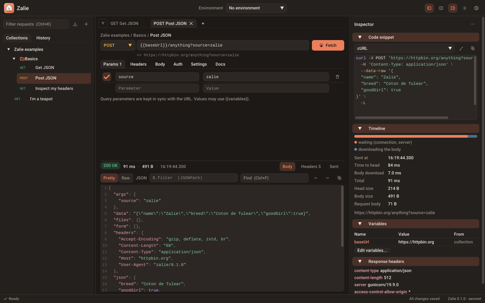

# The interface

{ .zalie-shot }

Zalie has three columns, all resizable (drag the separators) and the side ones can be hidden:

| Area | Content |
| ---- | ------- |
| Top bar | Logo, environment of the collection of the active request, buttons to toggle the sidebar (++ctrl+b++), the response layout, the inspector (++ctrl+j++), the theme, and the main menu |
| Sidebar (left) | Filter (++ctrl+k++), import and "new" buttons, the **Collections** tree and the **History** of the sent requests |
| Center | Request tabs, where the request lives (`Collection / Folder / Request`: click its name to rename it), URL bar, request editor (Params, Headers, Body, Auth, Settings, Docs) and the response viewer, below it or beside it |
| Inspector (right) | Configurable cards: code snippet, timeline, variables, response headers, notes. See [Inspector](inspector.md) |
| Status bar | Requests in flight (with a tiny Zalie running), save state, version |

The separator between the request editor and the response is draggable too. Sizes, visibility of the panels, layout,
theme and zoom are remembered.

## Response below or beside the request

By default the response is shown below the request editor. The columns button of the top bar (or **Settings >
Show the response beside the request**) puts it beside the editor instead, which suits wide screens and long
responses. When the window is too narrow for two columns (with the inspector open, for instance), the response goes
back below the editor until there is room again.

## Themes

Two themes, named after Zalie:

- **Coton**, the cream white of her fur, for the day.
- **Nuit**, a warm charcoal, for the night.

Both share a terracotta coral accent (the tiles she likes to sleep on). Switch with the sun / moon button of the top
bar, or in **Settings**.

## Zoom and HiDPI

The interface follows the scale of your monitor, and you can zoom with ++ctrl+equal++ / ++ctrl+minus++
(++ctrl+0++ to reset), or in **Settings**. Everything is vector or rendered at twice the resolution: crisp at any size.

## Toasts

Short notifications appear at the bottom right (imports, copies, errors) and vanish after a few seconds.
