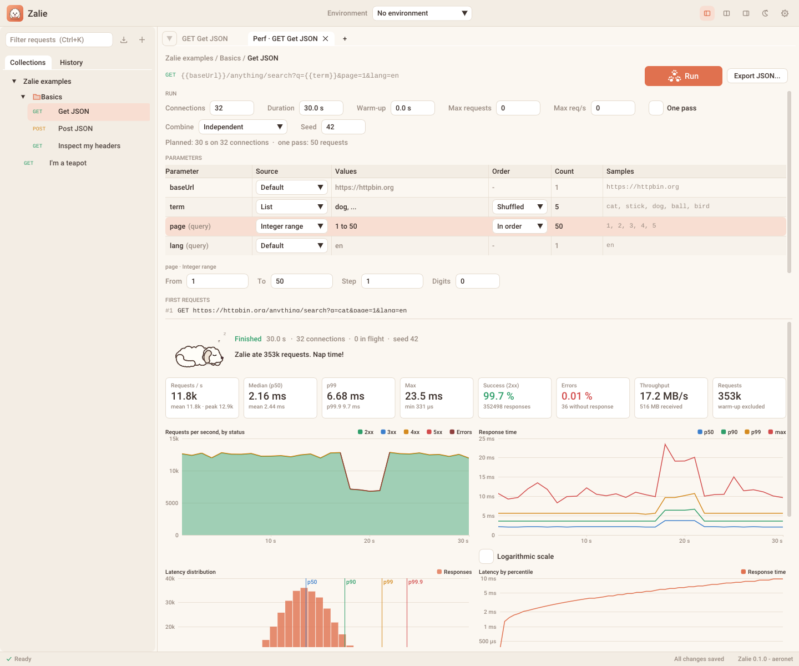

# Performance tests

Send a request many times, varying its parameters, and watch its throughput, response times and statuses live: a
load tester (in the spirit of wrk, oha or k6) built into Zalie, on top of the aeronet HTTP client.

{ .zalie-shot }

## Open a Performance tab

- The small arrow of the **Fetch** button opens its menu: **Performance test...**
- Or right click a request of the sidebar: **Performance test**.

The Performance tab opens next to the request it is bound to. It shows the request as written (its method and URL with
the `{{variables}}`), the settings of the run on top and the dashboard below; the separator between them is draggable.
Edits of the request in its own tab apply to the next run. ++ctrl+enter++ runs the active Performance tab and ++esc++
stops its run.

Performance tabs are not restored after a restart: export a run you want to keep (see [Export](#export-a-run)).

## Run settings

| Setting | Meaning |
| ------- | ------- |
| Connections | Each connection is a thread sending its next request as soon as the previous one is answered (the closed model of wrk). 0 uses the number of vCPUs, which is also the limit, unless raised in **Settings > Performance runs** |
| Duration | The run ends after this time, warm-up included. 10 s by default |
| Warm-up | The requests started during the first seconds are sent but not counted: connections are opened, caches warmed |
| Max requests | The run ends after this number of requests, warm-up included |
| Max req/s | The requests never go faster than this, whatever the number of connections |
| One pass | The run also ends once every value of the parameters has been sent |
| Combine | How the parameters advance together, see [below](#combine-the-parameters) |
| Seed | Equal seeds send equal requests (timestamps aside). 0 picks a new seed for each run |

For the limits, 0 means none, and the first limit reached ends the run. The line below the settings tells what the run
will send ("Planned: 2000 requests on 8 connections", "one pass: 150 requests"), or what prevents it: an empty range, a
`{{variable}}` without value, a missing data file...

The settings are saved in the collection, next to the request, so they can be shared and versioned with it. They are
left out of the collection file until a value is changed.

## Parameters

Every `{{variable}}` of the request gets a row of the parameter table (also those referenced by the values of other
variables), and so does every query parameter of its URL: no need to write `{{...}}` to vary `page=1`.

| Column | Content |
| ------ | ------- |
| Parameter | The variable, or the query parameter (marked "query", or "added" when only the run sends it). A name in orange has a problem, told below the settings |
| Source | **Default** sends what a normal Fetch sends: the value of the environment or of the collection, or the value written in the URL for a query parameter. Any other source varies the values for the run |
| Values | A summary of the values |
| Order | In order, at random, or shuffled (each value once per pass, in a random order) |
| Count | The number of distinct values, "unbounded" for random strings, UUIDs and timestamps |
| Samples | The first values the run will send |

Varying a query parameter only applies to the run: the request keeps its value, a normal Fetch keeps sending it.
The same goes for the buttons at the end of the rows:

- The cross of a query parameter leaves it out of the run (source **Not sent**). Its row stays, dimmed, and its plus
  sends it again.
- **+ Query parameter**, below the table, adds a query parameter that the request does not have: type its key in its
  row, choose its source, and the run appends it to the URL. Its cross removes it.

Click a row to edit its source below the table:

| Source | Settings | Example |
| ------ | -------- | ------- |
| Fixed value | the value | `en` |
| List | one value per line, typed or pasted | `dog`, `cat`, `bird` |
| Integer range | from, to, step, digits | `1` to `50`, `00001` to `99999` with 5 digits |
| Decimal range | from, to, step, decimals | `0.5` to `2` by `0.25` |
| Date range | from, to, step (seconds to days), format | each day of January 2026 as `2026-01-31` |
| Random string | length, characters | 8 lower-case letters |
| UUID | | a random version 4 UUID, derived from the seed |
| Timestamp | Unix seconds, milliseconds or ISO 8601 | the time of the request |
| Data file | path, format, column | `users.csv`, column `id` |
| Not sent | | a query parameter of the request left out of the run |

A range starts valid: from the value of the query parameter when it fits (`page=3` gives 3 to 102, `dates=2026-12-18`
gives a week from that day, in the same shape), otherwise from its defaults, today for dates.

The dynamic variables (`{{$randomUUID}}`, `{{$timestamp}}`...) are evaluated again for every request.

Below the editor, **First requests** lists the first requests as they will be sent, with their values encoded where
they land: percent-encoded in the URL, form-encoded in a form, escaped inside a JSON string.

### Data files

When there are many values, keep them in a file: plain text (one value per line), CSV with a header, or JSON Lines.
Type its path, or **drop the file on its row**. A path inside the directory of the collection is saved relative to
it, so that the collection stays portable. The file is never loaded in memory: it is indexed in the background (the
editor shows its number of rows, its columns, its first rows and its first malformed line), then the connections read
the rows they need. Several rows reading the columns of the same file stay together: a `user` goes with its `token`.

### Combine the parameters

- **Independent** (default): each parameter advances on its own. One pass covers the longest of them.
- **Together**: paired by position, the first values with the first values, like the columns of a file. One pass
  covers the shortest of them.
- **All combinations**: every combination, the last parameter advancing first, like nested loops (3 terms x 50 pages
  = 150 requests for one pass).

With **Together** and **All combinations**, the order of the first parameter applies to all of them.

## Run

**Run** (or ++ctrl+enter++) starts the run. Before a run against another host than the local machine (`localhost`,
`127.0.0.0/8`, `::1`), or with a method that may change data (anything but `GET`, `HEAD`, `OPTIONS` and `TRACE`), a
confirmation tells the host, the method and the planned volume.

**Stop** (or ++esc++) ends the run at once: no new request is sent, the requests in flight are not counted. Closing
the tab stops its run too, without waiting for the requests in flight.

During a run the dashboard refreshes about 10 times per second, not at the rate of the screen: the interface leaves
the CPU to the connections, and is idle again once the run is over. The status bar tells how many runs are in
progress.

{ width="240" }

Meanwhile Zalie eats a big piece of meat beside the status line, as fast as she can. The meat goes as the run
progresses (by time or by requests, whichever limit is closer), so the bare bone means the run is nearly over; without
a limit, a new piece comes every 8 seconds. Once the run is over, she naps. She chomps at the pace of the dashboard
refreshes: the animation costs no extra frame.

## Dashboard

- **Status line**, beside Zalie: phase (warming up, running, finished), measured time, connections, requests in
  flight and seed, then the progress of the run. A
  warning appears when the client, not the server, is the bottleneck (its CPU is above 90 % of what its connections
  can use): the numbers then measure Zalie more than the server.
- **Key numbers**: requests per second (current during the run, mean once over, and the peak), median, p99 and maximum
  response time, share of `2xx` and of errors, decoded throughput and requests counted.
- **Requests per second**, stacked by status class: a wave of `5xx` shows at once.
- **Response time**: p50, p90, p99 and max of each second, on a linear or logarithmic scale.
- **Latency distribution**: how many responses took each time, on a logarithmic axis, the percentiles marked.
- **Latency by percentile**: the time under which 50 %, 90 %, 99 %, 99.9 % of the responses were received.
- **Status distribution**: one bar split by class (green `2xx`, blue `3xx`, orange `4xx`, red `5xx`, dark red for the
  requests without response), then the count and share of each status code and of each kind of error (connection,
  TLS, timeout, closed, malformed, too large). Hover an error for its first message.
- **Response times** table: count, min, mean, standard deviation, percentiles and max, to the end of the body and to
  the response head, and per status class: fast errors would otherwise flatter the percentiles.

On the charts, hover to read the values of a second for every series, click a name of the legend to hide or show its
series. Once the run is over, drag over a chart over time to zoom on a window of it, and double click to show
everything again.

Response times are measured from the send of each request to the end of its body (or to its head), with a log-linear
histogram (about 6 % of precision at most) per connection. Bodies are counted, never kept nor analyzed: the run
measures the server, not Zalie.

## Export a run

**Export JSON...** writes the whole run to a file, `runs/<request>-<date>.json` in the [Zalie home](../reference/file-format.md)
by default: the request, the settings and the seed (to send the same requests again), the data files, the totals, the
percentiles, the histograms, the statuses, the errors and the time series. The format is described in
[Files and formats](../reference/file-format.md#run-reports).

## Good to know

- Each connection is a thread with its own HTTP client: hundreds of connections need hundreds of threads. Many
  streams multiplexed on a few HTTP/2 connections wait for the asynchronous client of aeronet.
- The HTTP version and the TLS settings of the request apply: set **HTTP version** to compare HTTP/1.1 and HTTP/2 on
  the same server.
- A long run keeps the time series of its last hour.
- Coming next (see the [Roadmap](../ROADMAP.md#performance-tab)): open model with a target rate, a new connection per
  request, bodies sent from files, breakdown of the latency by value of a parameter, slowest and failed samples, saved
  runs and their comparison, assertions and thresholds, and a command line runner.
