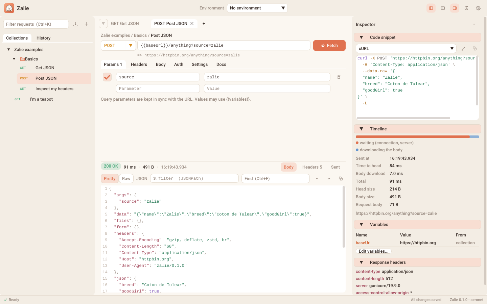
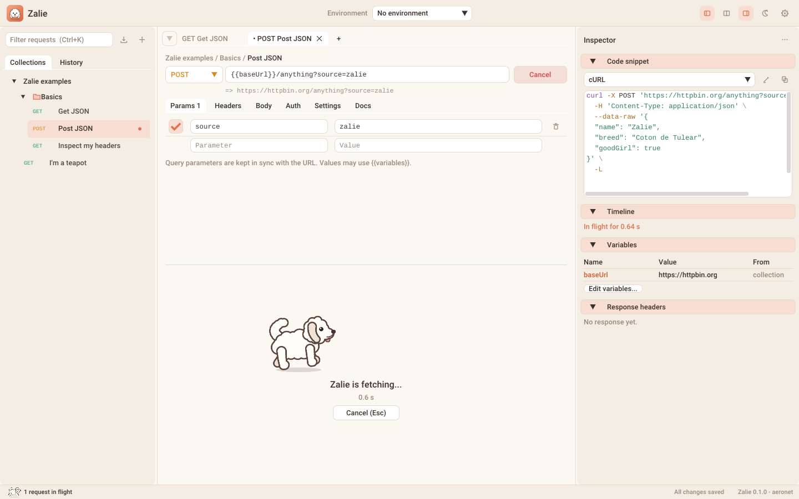

# Zalie

{ .zalie-logo }

**A light, fast and friendly HTTP client.**

Send requests, organize them in collections, inspect the responses and copy ready-to-paste code snippets.
A native C++23 application of a few megabytes, built on the [aeronet](https://github.com/sjanel/aeronet) HTTP client.

{ .zalie-shot }

## Why Zalie?

Tools like Bruno or Postman are great, but they are web applications in a box: hundreds of megabytes on disk and in
memory, slow to start, sluggish to scroll a big response. Zalie keeps the good ideas and drops the weight:

- **Native and small**: one executable of about 5 MB (Linux, release, stripped), no browser engine, no runtime.
  It starts in a fraction of a second.
- **Smooth with any response**: bodies are pretty-printed and indexed off the UI thread, then only the visible lines
  are laid out and drawn: the cost of a frame does not depend on the size of the body.
- **Idle means idle**: when nothing moves, Zalie sleeps until the next event: no CPU burnt redrawing a still window.
- **Git friendly**: one pretty-printed JSON file per collection, stable key order, autosaved.
- **Bruno and Postman import**: bring your existing collections (environments included) in one drag and drop.
- **JSONPath filter**: `$.results[*].id` on a 400 KB search response shows just what you look for, as typed.

## Features

| Area | Highlights |
| ---- | ---------- |
| Requests | All methods, query parameters kept in sync with the URL, headers, JSON / text / XML / form bodies, Basic / Bearer / API key authentication, per-request timeout, redirects, TLS verification, HTTP/1.1 or HTTP/2 |
| Variables | `{{variables}}` everywhere, collection variables, environments, dynamic values (`{{$timestamp}}`, `{{$randomUUID}}`...), process environment (`{{$env.TOKEN}}`) |
| Responses | Syntax highlighted JSON / XML / HTML, pretty or raw, JSONPath filter, find, line selection and copy, image preview, hex dump for binaries, headers, the request as sent; below or beside the request |
| Inspector | A configurable right panel: code snippet (cURL, HTTPie, Wget, PowerShell, Python, JavaScript, Go, C++ aeronet, raw HTTP), timeline, variables, response headers, notes |
| Collections | Folders, drag and drop, duplicate, rename, collection headers and authentication, history of sent requests |
| Import | Bruno collection folders, Postman v2.0 / v2.1 exports, curl commands (paste one in the URL bar) |
| Look and feel | Two themes, *Coton* (light) and *Nuit* (dark), HiDPI, zoom, and Zalie running while you wait |

## Meet Zalie

Zalie is a fluffy Coton de Tulear. She fetches everything you throw at her, so she fetches your responses too:
she runs while a request is in flight, and naps when there is nothing to do.

{ .zalie-shot }

Next: [install Zalie](getting-started/install.md), then [send your first request](getting-started/first-request.md).
